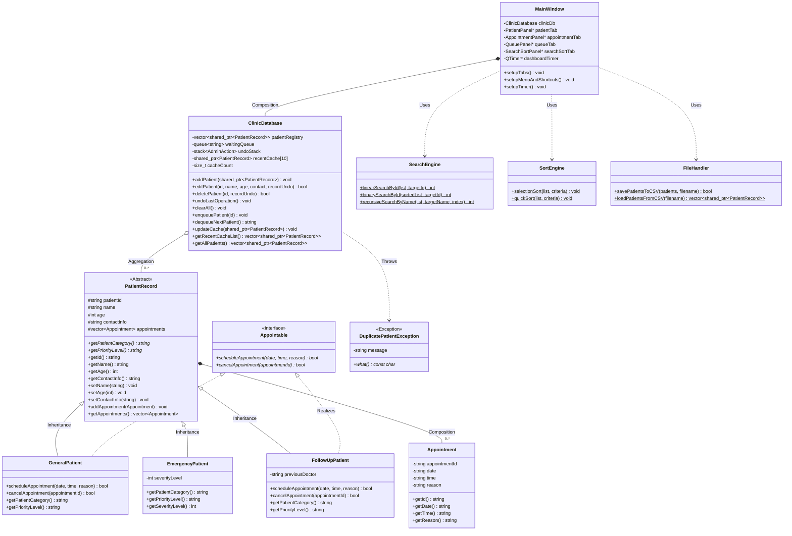

# SCAPMS – Smart Clinic Appointment & Patient Management System

**Course:** COS202 – Programming II (Lab Assessment Project)  
**Language & Standard:** C++17  
**GUI Framework:** Qt6 (`Qt6::Widgets`)  
**Build System:** CMake  
**Target Platform:** Pop!_OS / Ubuntu Linux (Cross-platform compatible)

---

## 1. Project Overview

The **Smart Clinic Appointment & Patient Management System (SCAPMS)** is a desktop graphical user interface (GUI) application engineered in C++17 and Qt6 to automate core administrative and clinical workflows for a university health center. 

The system provides an integrated, multi-tabbed environment that enables clinic staff to:
- Register, view, update, and delete patient records across multiple clinical categories.
- Enforce polymorphic appointment scheduling rules based on patient classification.
- Manage consultation waiting queues in strict First-In, First-Out (FIFO) order.
- Execute student-implemented searching and sorting algorithms across patient datasets.
- Reverse administrative actions using a Last-In, First-Out (LIFO) undo stack.
- Persist patient and appointment records to `.csv` files and generate real-time clinic summary reports.

---

## 2. System Features Checklist

- [x] **Patient Registration & CRUD:** Register, edit/update, and delete patients across `General`, `Emergency`, and `Follow-Up` categories.
- [x] **Polymorphic Appointment Management:** Schedule and cancel appointments for `Appointable` patients (`GeneralPatient`, `FollowUpPatient`) while restricting `EmergencyPatient` records to immediate triage via runtime `dynamic_cast`.
- [x] **FIFO Waiting Queue:** Enqueue and dequeue waiting patients using `std::queue`.
- [x] **Administrative Undo Stack:** Reverse the most recent `ADD_PATIENT`, `MODIFY_PATIENT`, or `DELETE_PATIENT` operation using `std::stack`.
- [x] **MRU Patient Cache:** Track recently accessed/attended patients in a fixed-size C++ array (`recentCache[10]`).
- [x] **Student-Implemented Sorting Algorithms:** Manual **Selection Sort** ($O(n^2)$) and **Quick Sort** ($O(n \log n)$) selectable by Name, ID, or Age.
- [x] **Student-Implemented Searching Algorithms:** Manual **Linear Search** (by ID and Category), **Binary Search** (by ID), and **Recursive Search** (by Name).
- [x] **Simple Clinic Reports:** Generates 4 analytical reports (*Patient Category Distribution*, *Patients with Pending Appointments*, *Most Frequently Attended / Recently Accessed Patients*, and *Daily Appointment & Queue Summary*).
- [x] **Advanced Qt6 GUI & Event Handling:** Dynamic input fields, custom color-coded table cells, `QFileDialog` CSV import/export, `QTimer` live status bar updates, tooltips, and keyboard shortcuts (`Ctrl+N`, `Ctrl+S`, `Ctrl+L`, `Ctrl+F`, `Ctrl+Q`).
- [x] **Exception Handling:** Custom `DuplicatePatientException` alongside `std::invalid_argument`, `std::out_of_range`, and `std::runtime_error` validation blocks.

---

## 3. UML Class Diagram

The following Mermaid diagram illustrates the inheritance hierarchy, abstract base class (`PatientRecord`), pure interface realization (`Appointable`), composition (`Appointment`), and controller relationships:



---

## 4. Project Directory Structure

The codebase enforces strict separation of responsibilities across four C++ namespaces (`Model`, `Controller`, `GUI`, `Utils`):

```text
scapms/
├── CMakeLists.txt
├── README.md
├── clinic_data.csv
├── include/
│   ├── model/
│   │   ├── PatientRecord.h         # Abstract base class
│   │   ├── Appointable.h           # Pure abstract interface
│   │   ├── Appointment.h           # Composition class for appointments
│   │   ├── GeneralPatient.h        # Derived class (PatientRecord + Appointable)
│   │   ├── EmergencyPatient.h      # Derived class (PatientRecord only)
│   │   └── FollowUpPatient.h       # Derived class (PatientRecord + Appointable)
│   ├── controller/
│   │   ├── ClinicDatabase.h        # Vector, Queue, Stack, Array Cache & Custom Exception
│   │   ├── SearchEngine.h          # Manual Linear, Binary & Recursive Search declarations
│   │   └── SortEngine.h            # Manual Selection Sort & Quick Sort declarations
│   ├── gui/
│   │   ├── MainWindow.h            # QMainWindow, MenuBar, QTimer, StatusBar
│   │   ├── PatientPanel.h          # Tab 1: CRUD, Undo, Dynamic Fields, CSV Save/Load
│   │   ├── AppointmentPanel.h      # Tab 2: Polymorphic Scheduling & Cancellation
│   │   ├── QueuePanel.h            # Tab 3: FIFO Waiting Queue management
│   │   └── SearchSortPanel.h       # Tab 4: Manual Search, Sort & 4 Clinic Reports
│   └── utils/
│       └── FileHandler.h           # Static CSV serialization & deserialization
└── src/
    ├── main.cpp                    # Application entry point
    ├── model/
    │   ├── GeneralPatient.cpp
    │   ├── EmergencyPatient.cpp
    │   └── FollowUpPatient.cpp
    ├── controller/
    │   ├── ClinicDatabase.cpp
    │   ├── SearchEngine.cpp
    │   └── SortEngine.cpp
    ├── gui/
    │   ├── MainWindow.cpp
    │   ├── PatientPanel.cpp
    │   ├── AppointmentPanel.cpp
    │   ├── QueuePanel.cpp
    │   └── SearchSortPanel.cpp
    └── utils/
        └── FileHandler.cpp
```

---

## 5. Data Structures & Algorithms Breakdown

### Data Structures (`Controller::ClinicDatabase`)
| Data Structure | Member Variable | Complexity | Purpose in SCAPMS |
| :--- | :--- | :--- | :--- |
| **`std::vector`** | `patientRegistry` | $O(1)$ random access | Dynamic storage of polymorphic `std::shared_ptr<PatientRecord>` objects. |
| **`std::queue`** | `waitingQueue` | $O(1)$ enqueue/dequeue | Manages consultation waiting order using strict FIFO semantics. |
| **`std::stack`** | `undoStack` | $O(1)$ push/pop | Stores `AdminAction` snapshots to reverse the most recent Add, Edit, or Delete action (LIFO). |
| **Fixed Array `[]`** | `recentCache[10]` | $O(1)$ index lookup | 10-slot Most-Recently-Used (MRU) cache tracking frequently/recently accessed patients. |

### Student-Implemented Algorithms
1. **Linear Search (`SearchEngine::linearSearchById` & Category Filter):**
   - **Complexity:** $O(n)$ Time, $O(1)$ Space.
   - **Use Case:** Searches unsorted patient records sequentially by ID or filters records matching a category (`General`, `Emergency`, `Follow-Up`).
2. **Binary Search (`SearchEngine::binarySearchById`):**
   - **Complexity:** $O(\log n)$ Time, $O(1)$ Space.
   - **Use Case:** Performs logarithmic lookup by Patient ID after sorting the dataset via Quick Sort.
3. **Recursive Search (`SearchEngine::recursiveSearchByName`):**
   - **Complexity:** $O(n)$ Time, $O(n)$ Call Stack Space.
   - **Use Case:** Demonstrates recursion with explicit base cases (list exhaustion or exact name match) and a recursive step (`index + 1`).
4. **Selection Sort (`SortEngine::selectionSort`):**
   - **Complexity:** $O(n^2)$ Time, $O(1)$ Space.
   - **Use Case:** In-place comparison sort ideal for small batches where minimizing memory swaps ($O(n)$ swaps) and avoiding call-stack overhead is desirable.
5. **Quick Sort (`SortEngine::quickSort`):**
   - **Complexity:** $O(n \log n)$ Average Time, $O(\log n)$ Stack Space.
   - **Use Case:** Divide-and-conquer recursive partitioning algorithm chosen for high performance and cache locality on larger clinic registries.

---

## 6. GUI Layout & Exception Handling Architecture

### Layout Management
- **`QFormLayout`:** Aligns label-input pairs in `PatientPanel` and `AppointmentPanel`.
- **`QVBoxLayout` & `QHBoxLayout`:** Composes responsive vertical sections and horizontal button bars that scale smoothly across screen resolutions.
- **`QTabWidget`:** Separates workflows into four logical panels (`1. Patient Records`, `2. Appointments`, `3. Waiting Queue`, `4. Search, Sort & Reports`).

### Exception Handling Strategy
All user-facing actions and file streams are guarded by `try-catch` blocks that surface clean `QMessageBox` dialogs rather than terminating the process:
- **`Controller::DuplicatePatientException`:** Custom exception thrown when registering a duplicate Patient ID.
- **`std::out_of_range`:** Thrown when patient age is non-numeric or outside the valid `[0, 120]` range.
- **`std::invalid_argument`:** Thrown when mandatory fields (Patient ID, Name) are submitted empty.
- **`std::runtime_error`:** Thrown when popping an empty undo stack or when `FileHandler` encounters a missing/unreadable `.csv` file.

---

## 7. Build & Execution Instructions

### Prerequisites (Pop!_OS / Ubuntu)
```bash
sudo apt update
sudo apt install build-essential cmake qt6-base-dev
```

### Compile & Run
```bash
# 1. Configure and build the project
cmake -S . -B build -DCMAKE_BUILD_TYPE=Debug
cmake --build build --config Debug --target all -j 4

# 2. Launch the application
./build/SCAPMS
```

### Keyboard Shortcuts
| Shortcut | Action |
| :--- | :--- |
| **`Ctrl + N`** | Start a new session (clears current in-memory registry) |
| **`Ctrl + S`** | Save patient and appointment records to CSV |
| **`Ctrl + L`** | Load patient and appointment records from CSV |
| **`Ctrl + F`** | Jump to the Search & Sort tab and focus the search bar |
| **`Ctrl + Q`** | Exit the application |

